# Runtime Hardware Trojan Detection and Regional Localization in an INT8 FPGA-CNN Accelerator

**Author:** Jeevan K. S.  
**Affiliation:** Department of Electronics and Communication Engineering, IIIT Dharwad, India

## Abstract

FPGAs are practical platforms for CNN inference but their datapaths, memories, interconnects, and control logic can be modified maliciously. This work integrates a reference-assisted runtime monitor into an INT8 LeNet-style CNN RTL design. The monitor does not consume Trojan-specific activation flags: it compares sampled Conv2 MAC products against reference products, checks the expected Conv2 feature address, and flags the T5 stall state. The clean reference also runs the monitor so false alarms are measured. The canonical 60-row matrix (ten MNIST workloads × Healthy/T1–T5) passed with TP=50, TN=10, FP=0 and FN=0; coarse regional localization was correct on 50/50 Trojan rows. The 95% Wilson intervals are 92.9–100% for TPR (50/50) and 0–27.8% for FPR (0/10), reflecting the small sample. Monitor detection latency is 149,137 cycles for T1–T3, 149,135 for T4, and 149,136 for T5 at 50 MHz. The separate 300-row held-out evaluation, Quartus resource/power reports, and physical DE10 observations are from the pre-monitor RTL revision and are not claimed as evidence for the current monitor. Fresh Quartus implementation and physical validation remain pending.

**Keywords:** Hardware Trojans, FPGA security, CNN accelerator, runtime detection, hardware monitoring, regional localization, INT8, MNIST, Cyclone V.

## 1. Introduction

Hardware security has become an important concern as integrated-circuit development increasingly relies on distributed supply chains, reusable intellectual property, external EDA flows, and programmable devices. A Hardware Trojan (HT) is a malicious modification introduced into a hardware design to alter functionality, leak information, degrade availability, or create a covert control path. Classic Trojan literature emphasizes the difficulty of detecting small or rarely activated malicious modifications using conventional functional verification alone [1].

The risk is particularly relevant to machine-learning accelerators. CNN implementations contain repeated arithmetic units, weight memories, activation buffers, interconnects, and control sequencers. A small change to one of these structures can affect an intermediate tensor while leaving the final top-1 classification unchanged for a selected workload. Previous work has demonstrated that neural-network implementations themselves can be targeted by hardware Trojans [2], while broader surveys identify Trojan attacks, side-channel leakage, and fault injection as important hardware-security dimensions for DNN accelerators [3].

This paper investigates a complementary defense direction: **runtime architectural monitoring with regional localization**. Instead of relying only on output classification or physical side channels, the proposed monitor checks selected internal invariants and exposes a compact detector/localization result at the FPGA board interface. The objective is not to claim universal Trojan detection, but to demonstrate a reproducible end-to-end methodology for detecting and regionally localizing a defined family of controlled Trojans.

The contributions are:
1. an INT8 LeNet-style FPGA-CNN reference implementation targeting Cyclone V;
2. five controlled Trojan variants spanning arithmetic, memory, interconnect, routing, and control regions;
3. a runtime detector with three regional localization classes;
4. a deterministic ten-workload simulation matrix covering Healthy and T1–T5;
5. a documented separation between current monitor-enhanced simulation evidence and pre-monitor Quartus/physical-board evidence; and
6. an evidence-cleaned reporting methodology that explicitly separates simulation metrics, FPGA implementation results, tool-estimated power, and physical observations.

## 2. Background and Threat Model

### 2.1 Hardware Trojans in DNN accelerators

Hardware Trojan research traditionally considers malicious additions or modifications to digital circuits and classifies them according to trigger, payload, activation condition, and location [1]. Neural-network accelerators provide additional attack surfaces because computation is distributed across many repeated MAC operations and memory accesses. Clements and Lao demonstrated the feasibility of inserting malicious hardware into neural-network implementations while preserving benign-test behavior and activating on selected inputs [2]. More recent surveys organize DNN hardware threats across Trojan, side-channel, and fault-injection categories [3].

Runtime detection is also an established research direction. Changepoint-based monitoring has been used to detect activated Trojans from runtime performance behavior [4], while other work has explored low-overhead runtime validation for FPGA implementations [5]. The present work adapts the runtime-monitoring concept to a CNN datapath and adds explicit **microarchitectural region codes**.

### 2.2 Threat model

The attacker is assumed to have RTL/netlist-level access during an untrusted design, IP, or synthesis stage. The attacker may add a small trigger and payload while attempting to preserve timing closure and avoid obvious classification errors on the evaluated clean workloads.

The controlled payload families are:
- **T1:** arithmetic corruption in a Conv2 processing element;
- **T2:** Conv2 weight-memory/data-path corruption;
- **T3:** feature-interconnect alteration between Pool1 and Conv2;
- **T4:** selective spatial source-routing alteration;
- **T5:** one-cycle control-sequencer stall.

The attacker is not assumed to bypass or compromise the runtime monitor itself. This is an important scope boundary: the study evaluates whether the monitor detects the selected controlled implementations, not whether every possible adversarial Trojan can be detected.

## III. Related Work and Positioning

The literature is grouped into CNN accelerator Trojan attacks, runtime/behavioral detection, Trojan localization, and lightweight accelerator security. Recent representative works include FeSHI [6], CNN resilience studies [7], [14], golden-reference-free localization [8], TrojanSAINT [9], interconnect attacks [11], two-level protection [12], and explainable LUT localization [13].

The project occupies a narrower runtime position: a compact digital monitor is embedded in the accelerator, controlled Trojans are inserted into multiple architectural regions, ten deterministic MNIST workloads are exercised, and selected variants are physically demonstrated on a Cyclone V DE10-Standard. Fine-grained graph/netlist localization and runtime architectural-region localization are complementary objectives rather than directly interchangeable methods.

## IV. Baseline FPGA CNN Accelerator

The reference accelerator processes 28x28 grayscale MNIST images using INT8 data. Conv1 uses 8 filters with 3x3 kernels, followed by ReLU and 2x2 max pooling. Conv2 uses 16 filters with 3x3 kernels over eight input channels, followed by ReLU and 2x2 max pooling. A fully connected classifier produces ten class scores followed by ArgMax.

The software reference accuracy is 98.41%. The verified synchronous-M10K Healthy reference requires 634,281 cycles at 50 MHz, or:

$T_{inf}=634281\times20\mathrm{ns}=12.68562\mathrm{ms}.$

The fresh C6 Healthy snapshot contains 1,153 ALMs, 912 registers, 71 RAM blocks, 455,104 block-memory bits, and 13 DSP blocks. Worst archived setup and hold slack are +0.181 ns and +0.173 ns.

## V. Experimental Inputs and Expected Outputs

Ten deterministic MNIST workloads represent classes 0 through 9. The canonical top-level interface reports predicted class on LEDR[2:0], detector status on LEDR3, and a two-bit regional code on LEDR[5:4].

Healthy uses localization 00. T1 uses 01 for Conv2 PE computation. T2 uses 10 for Conv2 weight/data path. T3, T4 and T5 use shared regional code 11 for interconnect/routing/control.

## VI. Hardware Trojan Experimental Setup

| ID | Target | Controlled payload | Region code |
|---|---|---|---|
| T1 | Conv2 PE | selected MAC product sign inversion | 01 |
| T2 | Conv2 weight/data path | selected weight bit flip | 10 |
| T3 | Conv2 interconnect | selected feature-interconnect alteration | 11 |
| T4 | Conv2 routing | selected source-address/routing alteration | 11 |
| T5 | Conv2 control | one-cycle control-path stall | 11 |

The injection/build flow is Healthy RTL -> controlled Trojan RTL -> Icarus simulation -> Quartus compile -> SOF -> DE10 programming. The same workload and clock configuration are retained across variants.

For this work, output-stealthy means that the selected Trojan-present run retains the same top-1 class as the corresponding Healthy run while the runtime monitor detects the internal anomaly. This is a workload-scoped definition.

## VII. Normal Runtime Signature Characterization

All ten Healthy rows report the expected class, detector 0, localization 00, and 634,281 inference cycles. This establishes controlled signature stability for the selected deterministic workload set. It does not constitute a complete PVT or application-distribution characterization.

## VIII. Proposed Lightweight Multi-Signature Anomaly Detection

The monitor checks three signals: (1) a sampled post-payload Conv2 MAC product against a reference product recomputed from the original feature/weight operands, (2) the registered Conv2 feature read address against the address implied by the operation counters, and (3) the T5 stall state. The public detector and localization outputs are driven by this monitor, not by the Trojan-specific t*_detected flags. The clean reference instantiates the same monitor so the ten Healthy rows measure false alarms.

The monitor assumes trusted clock/reset, operation counters, sampled reference operands, and monitor logic. It is a reference-assisted checker for this controlled Trojan campaign, not a tamper-proof security island or a general detector for arbitrary unknown Trojans.

## IX. Trojan Localization

The localization map is:

- 00: Healthy;
- 01: Conv2 PE computation;
- 10: Conv2 weight/data path;
- 11: shared interconnect/routing/control.

The 11 code intentionally does not distinguish T3 from T4 or T5; it also represents ambiguous arithmetic signatures. In the monitor-enhanced canonical simulation matrix, T1 is localized to 01 on 10/10 rows, T2 to 10 on 10/10, and T3–T5 to shared code 11 on 30/30 rows.

## X. Results and Discussion

### A. Detection performance

The monitor-enhanced 60 simulation rows contain ten Healthy and 50 Trojan cases: TP=50, TN=10, FP=0, FN=0. Point estimates are TPR/recall=100%, FPR=0%, precision=100%, and F1=1.000. The 95% Wilson intervals are 92.9–100% for TPR and 0–27.8% for FPR. These values apply only to the selected controlled matrix and do not imply universal detection.

### B. Detection latency

The monitor-facing ledger records T1–T3 detection latency of 149,137 cycles (2.98274 ms), T4 of 149,135 cycles (2.98270 ms), and T5 of 149,136 cycles (2.98272 ms) at 50 MHz. The same per-variant latency was recorded across the ten canonical workloads.

### C. CNN functional impact

All 50 Trojan-present rows retain the expected top-1 class. This demonstrates output-stealthy behavior for the selected controlled cases and does not prove universal stealthiness.

### D. Legacy pre-monitor hardware resource evidence

| Target | ALMs | Registers | RAM | DSP | Setup slack | Hold slack |
|---|---:|---:|---:|---:|---:|---:|
| Healthy | 1153 | 912 | 71 | 13 | +0.181 ns | +0.173 ns |
| T1 | 1170 | 918 | 71 | 13 | +0.141 ns | +0.141 ns |
| T2 | 1192 | 919 | 71 | 15 | +0.163 ns | +0.163 ns |

The table above describes the pre-monitor RTL and cannot quantify the independent monitor's hardware overhead. The monitor-enhanced RTL needs a fresh Quartus rebuild under identical constraints; exact final T3–T5 fitter counts and fresh-C6 Fmax remain unavailable.

### E. Power estimates

The archived Quartus Power Analyzer estimates (463.79–467.17 mW across Healthy/T1–T5) belong to the pre-monitor RTL. They are tool estimates, not physical rail/current measurements, and do not quantify the monitor-enhanced revision.

### F. Ablation and security-overhead trade-off

An evidence-bounded numerical evaluation-layer ablation is derived from the committed 60-row ledger by masking the observable decision channels. Final CNN classification alone gives 0% TPR because the selected Trojans are output-stealthy; timing alone gives 20% TPR because only T5 changes the total inference-cycle count; accepting only regional code 01, 10, or 11 gives 20%, 20%, and 60% TPR, respectively; accepting any non-zero regional code gives 100% TPR with 0% FPR. This is a coverage ablation over already implemented monitor events, not a separate set of synthesized no-monitor/PE-only/memory-only hardware builds, so no independent resource-overhead delta is claimed.

## XI. Robustness, Stealthiness, and Generalization

A historical held-out same-CNN experiment evaluated 50 Healthy-correct images across Healthy/T1–T5 (300 simulation rows) using the pre-monitor RTL and Trojan-self-reporting flags. Those results are not evidence for the independent monitor and are excluded from current monitor metrics. The 300-row campaign must be rerun with this monitor-enhanced revision before claiming held-out performance.

The prior held-out result is conditional on Healthy-correct images and is not an estimate across all MNIST inputs. It is also a pre-monitor result. The current monitor is validated only on the canonical ten-workload matrix; cross-CNN generalization, a monitor-enhanced held-out evaluation, and trigger/payload-severity sweeps remain future work.

## XII. Cross-Layer Security Analysis

Each controlled Trojan maps from a defined architectural region to a detector event and regional code. The important cross-layer observation is that detection occurs while the selected Trojan-present runs retain the expected CNN class. This demonstrates that runtime internal monitoring can expose a selected anomaly before output-level misclassification is required.

## XIII. Comparison With State of the Art

| Work | Main objective | Resolution | Runtime FPGA CNN | Physical validation |
|---|---|---|---|---|
| Clements & Lao | CNN Trojan attack | Architecture-dependent | No | No |
| Odetola et al. | Stealthy CNN Trojan attack | Feature-map level | PYNQ | Yes |
| Yasaei et al. | Golden-reference-free localization | RTL node | No | No |
| TrojanSAINT | Detection + localization | Gate level | No | No |
| Hou et al. | CNN interconnect attack + PUF defense | Interconnect | Yes | Yes |
| Su et al. | Explainable LUT localization | LUT/node | No | No |
| This work | Reference-assisted runtime detection + regional localization | 3 coarse regions | Canonical RTL simulation | Legacy pre-monitor only; monitor-enhanced hardware pending |

This comparison is by objective and evidence layer, not a universal performance ranking.

## XIV. Reproducibility

Canonical simulation and monitor unit tests:

~~~bash
cd ~/hardware-trojan-fpga-cnn
bash verification/run_monitor_unit_tests.sh
chmod +x verification/run_full_matrix.sh
./verification/run_full_matrix.sh
~~~

The repository contains the workload manifest, 60-row simulation ledger, RTL/testbenches, Quartus projects, physical validation record, paper tables/figures, and professor submission scripts.

## XV. Limitations and Threats to Validity

1. The 60-row matrix is controlled RTL simulation, not 60 independent physical measurements.
2. The held-out 300-row matrix has not been rerun with the independent monitor.
3. The monitor-enhanced RTL has no fresh Quartus resource/timing report or physical DE10 validation yet.
4. Legacy Quartus Power Analyzer values are estimates; physical rail/current power was not measured.
5. Exact legacy T3–T5 fitter counts and fresh C6 Fmax are not archived.
6. Code 11 is shared by T3/T4/T5 and ambiguous arithmetic signatures.
7. Only one compact MNIST CNN is evaluated.
8. The ablation is evaluation-layer channel masking, not independently synthesized monitor variants.
9. No trigger-probability or payload-severity sweep was performed.
10. The monitor assumes trusted clock/reset, operation counters, sampled reference operands, and monitor logic.

## XVI. Conclusion and Future Perspective

The monitor-enhanced INT8 FPGA-CNN RTL passed the canonical 60-row simulation matrix and dedicated monitor unit tests. It detected all 50 controlled Trojan rows, raised no alerts on ten healthy rows, and localized the anomalies at the defined coarse resolution. The older Quartus and DE10 evidence belongs to the pre-monitor RTL. Fresh synthesis, held-out evaluation, and physical validation are required before claiming hardware overhead or on-board effectiveness for the independent monitor.

The result is a controlled research prototype rather than a universal detector. Future work should add physical power instrumentation, a graded trigger-probability/payload-severity sweep, independently synthesized monitor-ablation variants, additional CNNs, broader datasets, and finer localization.

## Figures (Professor-template numbering)

### Figure 13

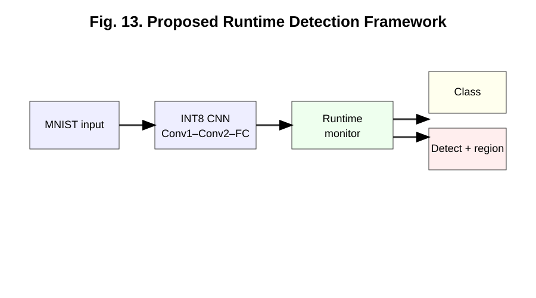

*Overall proposed runtime detection and localization framework.*

### Figure 14

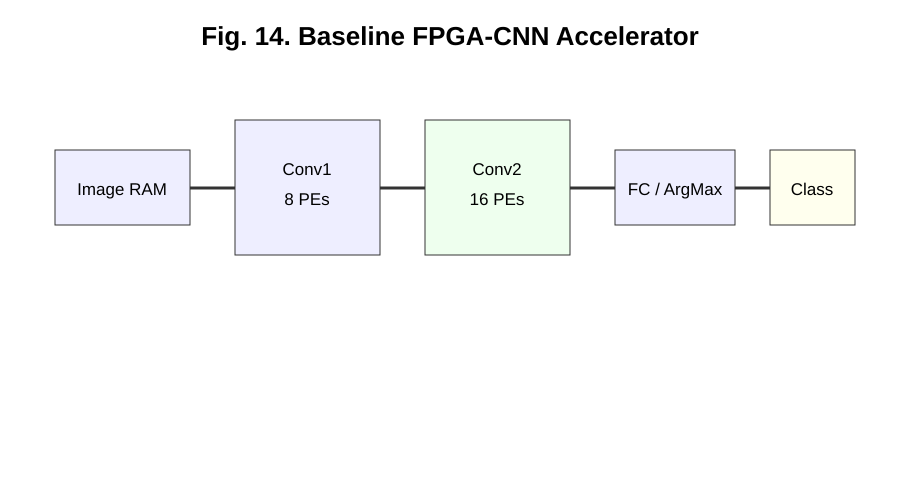

*Baseline FPGA CNN accelerator architecture.*

### Figure 15

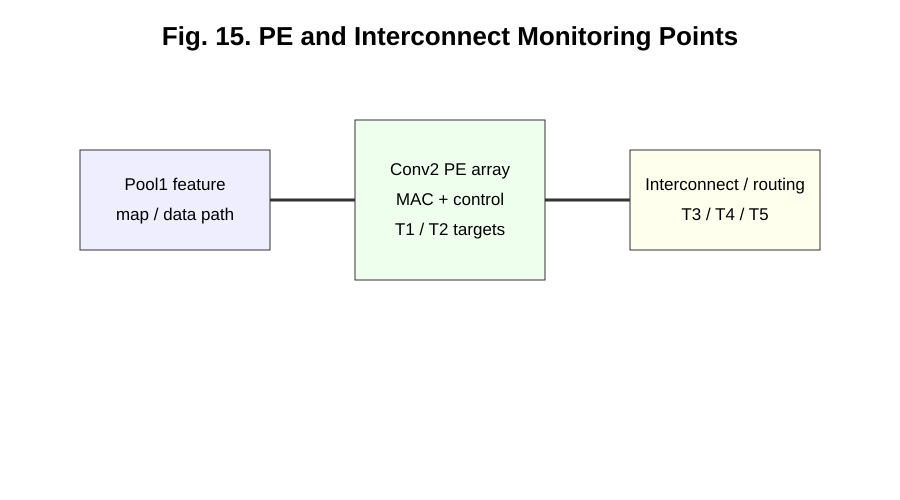

*Processing-element/interconnect organization and monitoring points.*

### Figure 16

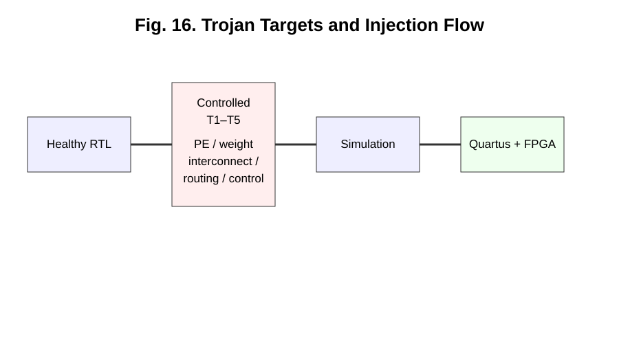

*Controlled Trojan target regions and injection/build flow.*

### Figure 17

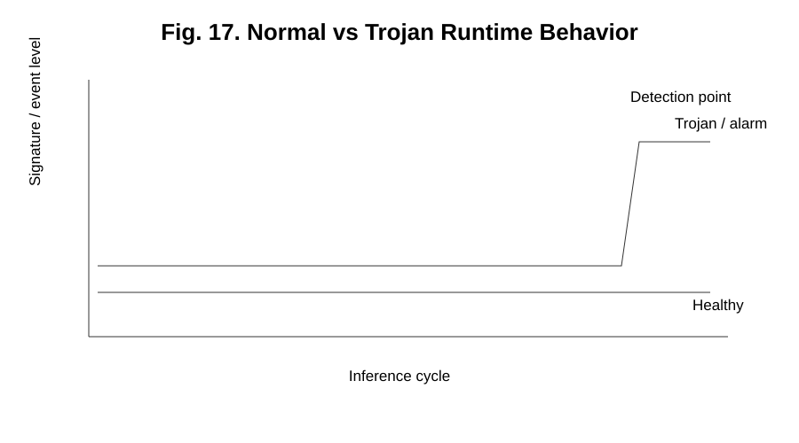

*Normal-versus-Trojan runtime behavior (selected controlled workloads).*

### Figure 18

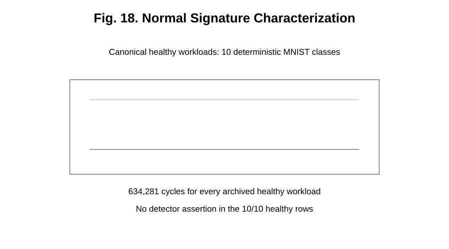

*Normal signature characterization from the canonical workload set.*

### Figure 19

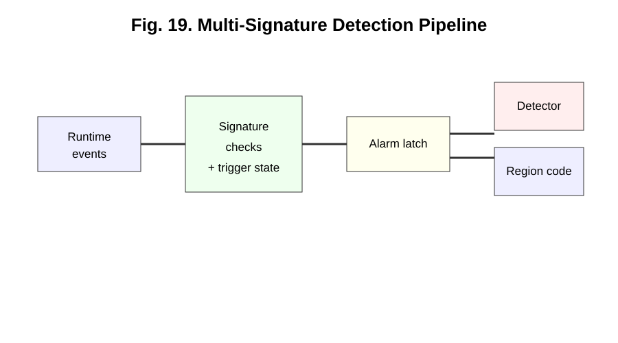

*Runtime multi-signature detection procedure.*

### Figure 20

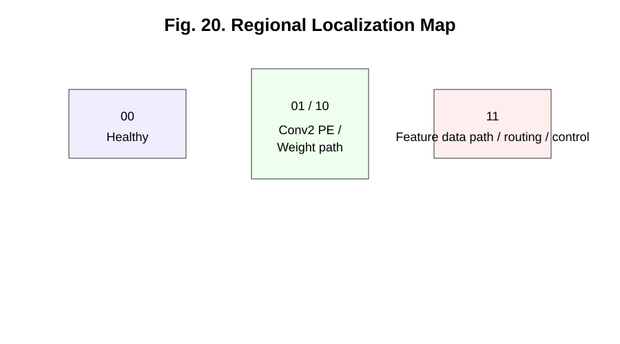

*Regional localization map; code 11 is shared by T3/T4/T5.*

### Figure 21

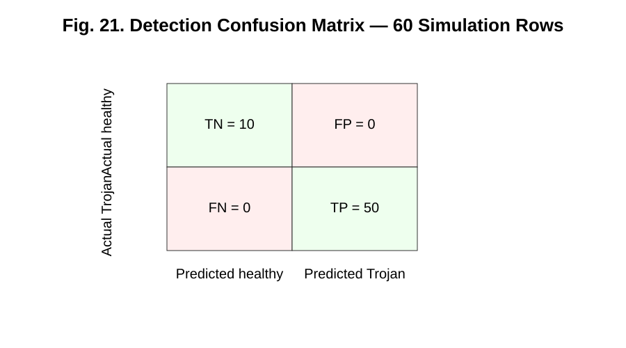

*Detection confusion matrix for the canonical 60-row simulation matrix.*

### Figure 22

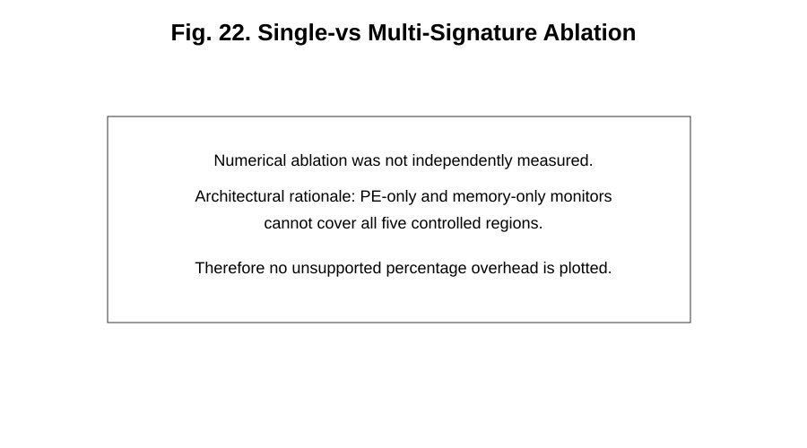

*Evaluation-layer channel-masking coverage ablation; not separate synthesis builds.*

### Figure 23

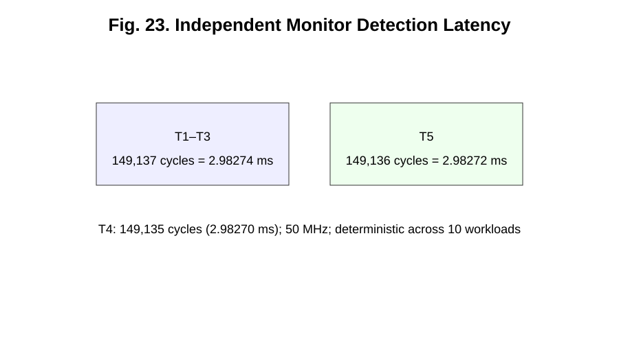

*Detection latency evidence from the canonical cycle-count ledger.*

### Figure 24

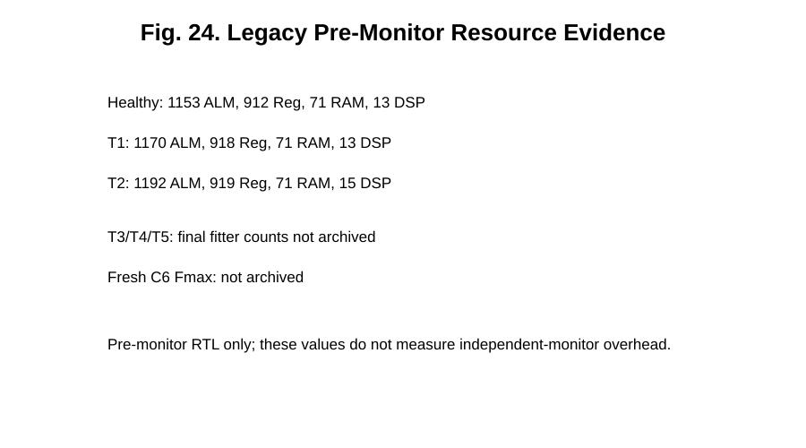

*Legacy pre-monitor hardware resource evidence; it does not quantify the independent monitor overhead.*

### Figure 25

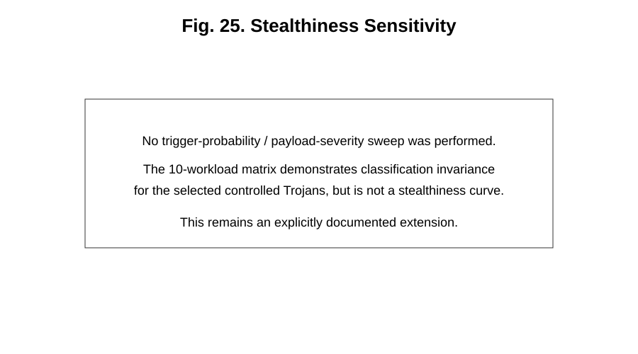

*Output-stealthiness and timing observability across the five selected variants.*

### Figure 26

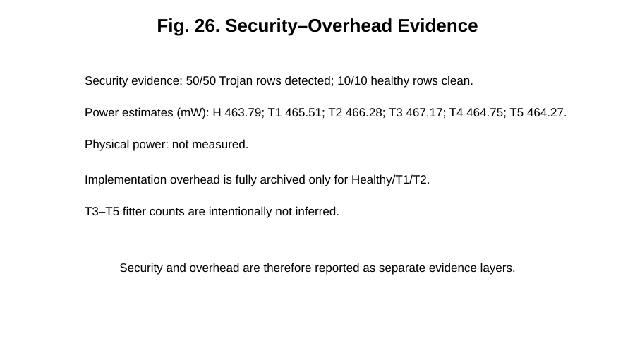

*Security/overhead evidence layers, with power explicitly labeled as a tool estimate.*

### Figure 27

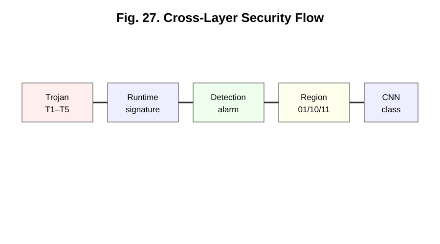

*Cross-layer mapping from Trojan region to monitor event, localization, and output impact.*

## References

[1] R. S. Chakraborty, S. Narasimhan, and S. Bhunia, “Hardware Trojan: Threats and emerging solutions,” *2009 IEEE International High Level Design Validation and Test Workshop*, pp. 166–171, 2009. doi: [10.1109/HLDVT.2009.5340158](https://doi.org/10.1109/HLDVT.2009.5340158).

[2] J. Clements and Y. Lao, “Hardware Trojan Attacks on Neural Networks,” arXiv:1806.05768, 2018. [https://arxiv.org/abs/1806.05768](https://arxiv.org/abs/1806.05768).

[3] S. Mittal, H. Gupta, and S. Srivastava, “A survey on hardware security of DNN models and accelerators,” *Journal of Systems Architecture*, vol. 117, art. 102163, 2021. doi: [10.1016/j.sysarc.2021.102163](https://doi.org/10.1016/j.sysarc.2021.102163).

[4] R. Elnaggar, K. Chakrabarty, and M. B. Tahoori, “Hardware Trojan Detection Using Changepoint-Based Anomaly Detection Techniques,” *IEEE Transactions on Very Large Scale Integration (VLSI) Systems*, vol. 27, no. 12, pp. 2706–2719, 2019. doi: [10.1109/TVLSI.2019.2925807](https://doi.org/10.1109/TVLSI.2019.2925807).

[5] B. J. Mohd, S. Abed, T. Hayajneh, and M. H. Alshayeji, “Run-Time Monitoring and Validation Using Reverse Function (RMVRF) for Hardware Trojans Detection,” *IEEE Transactions on Dependable and Secure Computing*, vol. 18, no. 6, pp. 2689–2704, 2021. doi: [10.1109/TDSC.2019.2961902](https://doi.org/10.1109/TDSC.2019.2961902).

[6] T. A. Odetola et al., “FeSHI: Feature Map-Based Stealthy Hardware Intrinsic Attack,” *IEEE Access*, vol. 9, pp. 115370–115387, 2021. doi: [10.1109/ACCESS.2021.3104520](https://doi.org/10.1109/ACCESS.2021.3104520).

[7] P. Sun, B. Halak, and T. J. Kazmierski, “Towards Hardware Trojan Resilient Design of Convolutional Neural Networks,” *2022 IEEE 35th International System-on-Chip Conference (SOCC)*, pp. 1–6, 2022. doi: [10.1109/SOCC56010.2022.9908104](https://doi.org/10.1109/SOCC56010.2022.9908104).

[8] R. Yasaei, S. Faezi, and M. A. Al Faruque, “Golden Reference-Free Hardware Trojan Localization Using Graph Convolutional Network,” *IEEE Transactions on Very Large Scale Integration (VLSI) Systems*, vol. 30, no. 10, pp. 1401–1411, 2022. doi: [10.1109/TVLSI.2022.3191683](https://doi.org/10.1109/TVLSI.2022.3191683).

[9] H. Lashen et al., “TrojanSAINT: Gate-Level Netlist Sampling-Based Inductive Learning for Hardware Trojan Detection,” *2023 IEEE International Symposium on Hardware Oriented Security and Trust (HOST)*, 2023. [https://arxiv.org/abs/2301.11804](https://arxiv.org/abs/2301.11804).

[10] P. Li, C. Che, and R. Hou, “Nacc-Guard: A Lightweight DNN Accelerator Architecture for Secure Deep Learning,” *Research Square* preprint, 2023. doi: [10.21203/rs.3.rs-3272285/v1](https://doi.org/10.21203/rs.3.rs-3272285/v1). This is a preprint, not represented here as a peer-reviewed journal publication.

[11] J. Hou, Z. Liu, Z. Yang, and C. Yang, “Hardware Trojan Attacks on the Reconfigurable Interconnections of Field-Programmable Gate Array-Based Convolutional Neural Network Accelerators and a Physically Unclonable Function-Based Countermeasure Detection Technique,” *Micromachines*, vol. 15, no. 1, art. 149, 2024. doi: [10.3390/mi15010149](https://doi.org/10.3390/mi15010149).

[12] Z. Liu, J. Hou, J. Wang, and C. Yang, “A Novel Two-Level Protection Scheme against Hardware Trojans on a Reconfigurable CNN Accelerator,” *Cryptography*, vol. 8, no. 3, art. 34, 2024. doi: [10.3390/cryptography8030034](https://doi.org/10.3390/cryptography8030034).

[13] H. Su, W. Hu, X. Zhang, D. Zhu, and L. Wu, “Toward Precise and Explainable Hardware Trojan Localization at LUT Level,” *IEEE Transactions on Computer-Aided Design of Integrated Circuits and Systems*, vol. 44, no. 7, pp. 2817–2821, 2025. doi: [10.1109/TCAD.2025.3522266](https://doi.org/10.1109/TCAD.2025.3522266).

[14] P. Sun, B. Halak, and T. J. Kazmierski, “Towards Hardware Trojan Resilient Convolutional Neural Network Accelerators,” *Journal of Hardware and Systems Security*, 2025. doi: [10.1007/s41635-025-00164-y](https://doi.org/10.1007/s41635-025-00164-y).

